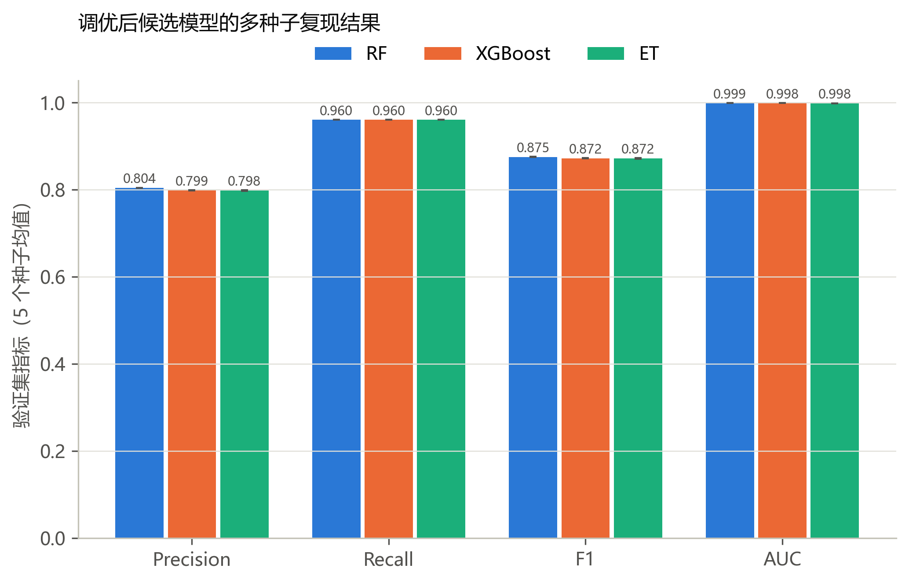

# 第 8 步主对比：调优后候选模型的多种子复现

种子 20260927, 20260928, 20260929, 20260930, 20260931；每个种子重新拟合预处理器与模型，并在验证集上重新选阈值（§7.3）。表中为均值 ± 标准差（总体标准差）。

表 7　多种子复现结果

| 指标 | RF | XGBoost | ET |
|---|---:|---:|---:|
| Precision | **0.8038 ± 0.0002** | 0.7985 ± 0.0007 | 0.7981 ± 0.0013 |
| Recall | **0.9600 ± 0.0000** | **0.9600 ± 0.0000** | **0.9600 ± 0.0000** |
| F1-score | **0.8750 ± 0.0001** | 0.8719 ± 0.0004 | 0.8716 ± 0.0008 |
| Accuracy | **0.9897 ± 0.0000** | 0.9894 ± 0.0000 | 0.9893 ± 0.0001 |
| AUC | **0.9986 ± 0.0000** | 0.9984 ± 0.0000 | 0.9983 ± 0.0000 |
| Macro-F1 | **0.9348 ± 0.0001** | 0.9332 ± 0.0002 | 0.9330 ± 0.0004 |
| PR-AUC | **0.9657 ± 0.0005** | 0.9613 ± 0.0003 | 0.9561 ± 0.0007 |
| FPR | **0.0092 ± 0.0000** | 0.0095 ± 0.0000 | 0.0095 ± 0.0001 |
| FNR | **0.0400 ± 0.0000** | **0.0400 ± 0.0000** | **0.0400 ± 0.0000** |
| 阈值 | 0.3424 | 0.3068 | 0.3399 |
| 单条延迟 P95（ms） | 4.952 | 0.710 | 3.698 |
| batch=1024 吞吐（条/秒） | 99,068 | 618,856 | 106,852 |
| 模型体积（MB） | 74.36 | 1.60 | 115.76 |
| 训练用时（s） | 119 | 4 | 94 |

## 选型判定（§7.4）

| 模型 | FNR 标准差 ≤ 2% | 平均 FNR ≤ 5% 且 FPR ≤ 1.5% | Macro-F1 均值 |
|---|---|---|---:|
| RF | 是 | 是 | 0.9348 |
| XGBoost | 是 | 是 | 0.9332 |
| ET | 是 | 是 | 0.9330 |

选定 T1 模型：**XGBoost**（Macro-F1 最高者 RF；差距 ≤ 0.003 的并列候选：RF, XGBoost, ET）。
