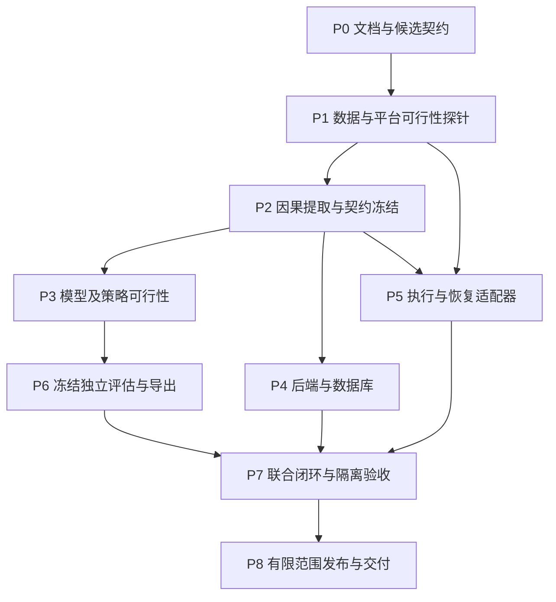

# 开发路线

版本：host-guard v5，更新于 2026-10-04。这是唯一实施路线。P0 已完成；P1 数据可行性出口通过，严格平台出口未通过，整体 blocked，详见 [P1 证据](p1/README.md)和[出口裁决](p1/stage-exit.json)。P2 已实现独立 v5 因果提取、IPC 原型和数据分区，验收及限制见[P2](p2/README.md)；P3—P8 尚未实施。旧路线的完成记录不自动成为新阶段证据。前端完全排除，由用户后续自行适配。

## 1. 执行原则

1. 先证明数据、可观测性与操作系统动作可行，再铺完整工程。前期探针不依赖完整模型、数据库或UI。
2. 把研究资格、联合验收资格、真实资产自动运行资格分开。开发数据合格可训练，不等待持续影子观测；模型高分也不能直接获得执行权。
3. 各阶段列出的命令、测试和产物是**待实现/待执行清单**，不是当前可运行能力。实现阶段先核对实际CLI/API，再登记精确命令和退出码。
4. 既有用户授权覆盖的工作连续完成，不逐步骤重复询问；新增主机/接口/动作/时限必须先明确，实验标签不构成系统操作授权。
5. 所有报告包含代码/数据/配置/契约哈希、环境、命令、输出摘要、失败和下一步。阶段状态为 planned/running/passed/failed/blocked；有历史实现不等于新阶段passed。
6. 一个失败仅阻断依赖它的能力。模型、传感器、执行器可以并行研发；不能为了推进最终发布忽略联合门槛。

## 2. 依赖与最短可行路径

| 阶段 | 必须回答的问题 | 可独立继续的工作 |
|---|---|---|
| P1 | 数据和平台能支撑至少一项真实自动阻断能力吗 | 某平台失败不阻断其他平台探针 |
| P2 | 相同实时/离线输入能产生无未来信息的特征吗 | 模型原型与执行器设计可使用已冻结子集 |
| P3 | 在低误伤下，模型能带来有效覆盖吗 | P4/P5不等待模型最终成绩 |
| P4/P5 | 检测对象和执行对象确实一致、能恢复吗 | 先用固定夹具完成组件验证 |
| P6/P7 | 未见活动上的模型与真实动作能联合通过吗 | 未通过能力保留诊断，已通过能力单独登记 |
| P8 | 可复现、可回退、可按授权范围运行吗 | 不依赖页面完成 |

单人实施的默认顺序为P1→P2→P3可行性→P4/P5完整工程→P6/P7→P8。依赖图允许并行，但不要求启动多个代理或同时铺开所有模块；在P3证明模型有收益前，后端只做契约/夹具骨架，避免过早投入完整集成。

## P0 文档与候选契约

### 输入与范围

本会话批准的重构方向、本地干净基线 `9270646acb479214236e3dec7cbe2b2795be22de`，不修改应用代码/SQL/训练资产/服务。

### 工作及产物

- 重写架构、模块、接口、数据库；建立检测与处置契约、模型方案、验证方案、迁移清单和本文。
- 给出观察、模型manifest、策略、签名命令、回执的JSON Schema以及去敏结构示例。
- 删除过期阶段报告与路线入口；仅保留现有测试按哈希依赖的v4规格作为兼容夹具。
- 更新仓库协作规则，移除持续影子验收前置要求，不改变真实资产授权和回滚约束。

### 出口

相对链接无断链、Schema自校验及样例结构验证通过、特征顺序一致、权限/状态/对象术语一致、git diff --check通过。声明式契约未被放入运行时资源目录，不会被旧程序自动加载。源码/迁移/锁文件/前端无变更。

## P1 数据与平台可行性探针

### 当前执行结果（2026-10-04）

用户明确授权 win-dev 直接测试。初次数据关联失败完整保留，已完成 Torii 两个捕获、CIC 修正标签和两个完整工作日 PCAP 的补证，以及授权正常 HTTP 任务。111/111 条 CIC 抽查关联匹配；20 条 Slowloris 起点审查中 5 条满足结构条件，3 条在发布者观察窗口内具有后续候选快照时刻。任务收敛为单个 HTTP 服务入站慢请求/连接滥用，数据可行性出口通过，全量 prefix 标签未批准。P1 整体仍 blocked，不以数据通过抵消平台截止时效失败。

Windows 原 canary 已实际启动，4551 未再现但原因未知；官方 Npcap 1.89 和实际抓包已验证。窄规则、既有/新连接、30 秒到期、进程退出及断连已实测；第一次启动清理过慢，拆分任务后第二次启动 25.9 秒清零，但仍超过原定 TTL 约 19.7 秒。全部本任务规则/任务已清理，Mac 仅只读预检、无 auto 能力。平台证明有界可行性，不能替代 P5/P7 的严格生产恢复验收。详见 [补证报告](p1/continuation-report.md)。用户补充非必要禁止重启；后续优先进程级试验，不再主动安排重启。

后续明确授权的[WFP动态恢复补证](p1/wfp-dynamic-probe.md)已完成：六项非重启场景通过，另执行一次获准重启，重启后无残留并实际拒绝旧boot命令。因缺少截止时间内清零观察、自动启动观察任务退出1，严格跨重启TTL仍未验证，P1继续blocked；没有追加重启，所有试验规则/任务/进程已清零。Mac按用户要求暂缓，周五仍仅镜像校验。P2数据依赖关系不变，本次未实施P2。

遵守“失败只阻断依赖能力”的原则，P1 补证时允许 P2 数据/因果提取独立推进；后续已实施的 P2 见下一节。Windows 恢复时效和 Mac 范围/动作证据是明确保留的缺口，不授予自动资格，也不把 P1 整体改为 passed。

### 入口

P0完成，用户授权对应开发与试验范围；确认本机仓库与Windows训练仓库、分支、脏文件、运行时和真实主机身份。阶段优先预算为两个工作日的有界探针，超时必须报告具体阻塞，不自动扩大下载或改系统安全策略。

### P1-D 数据探针

1. 从CIC修正版/现有对应PCAP和IoT-23至多两个候选开始；记录许可、来源版本、文件大小/哈希、标签定义。
2. 下载/复用完整小场景，总原始预算2GiB；已核验文件复用。修正表格可用于分析，但早期模型必须能关联原始报文。
3. 抽查至少30个标注连接（正负各至少10个，剩余覆盖边界）能否定位到包/活动；另列Unknown和不一致，不能由抽查通过推断全量无误。
4. 验证至少一个目标攻击家族和相似良性行为可观测；核对能否取得多次独立活动供开发和最终验证，不能把单一攻击活动切成三份假装泛化。
5. 形成可观测性表：特征、采集点、方向、协议、标签起点、缺失、目标引用是否可构造。
6. 如果只有完整连接标签而无起点，只允许final研究；必须找到可解释的prefix标注方案才能承诺早期自动阻断。

产物：source-manifest、label-policy、sample-join-audit、coverage-matrix、原件/派生哈希清单。原始数据和地址账本不进Git。

### P1-P 平台探针

1. 在明确授权的自有隔离测试环境，先核验平台版本、抓包依赖、应用控制、权限和网络层隔离。
2. Windows先验证一个最小签名/可运行测试程序能否启动、Npcap是否可用；若系统4551等策略阻止，记录原因，不关闭防护绕过。
3. macOS/Windows分别验证：本系统独立规则命名空间、对端+服务+方向的最小范围、管理连接保护。
4. 使用普通TCP canary，测试新连接及已有连接在添加规则后的真实效果；观察其他连接不被误伤。
5. 用独立恢复器验证30秒到期、进程退出、控制面断开和主机重启后的规则归属/清理。探针可用最小本地工具，不等完整后端。
6. 若Mac平台无法证明粒度或恢复，Mac不能宣布auto；可先让Windows获得相应能力，但必须在此阶段明确双平台交付缺口。

产物：platform-capability-probe，记录OS版本、适配方式、规则前后连接结果、TTL和故障恢复。不是只记录命令退出码。

### 出口、失败及回退

- 数据出口：至少一个家族具备可关联正例/困难负例及可取得的独立活动，能够按新契约计算核心特征；明确全量样本预算。
- 平台出口：至少一个目标平台真实证明窄规则及恢复，另一个平台也必须有明确结果，不能留到最终才验证。
- 关联失败→修标注/连接定义；缺可观察信号→改任务或特征；样本规模不够→定向补充活动；平台失败→调整已验证动作或明确平台不支持。每项有下一实验，而非笼统“换数据集”。
- 探针结束清理本任务规则，保留可恢复日志/证据；不动用户原有规则、数据和工具。

## P2 因果提取与契约冻结

### 当前实施结果（2026-10-04）

独立 `internal/hostguard`、`guardextract`、`guardjoin`、`guardgolden` 已实现，冻结研究候选为 `5.0.0-rc.2`。周三完整原件读取 13,788,878 帧，输出 293,378 条观察；全量试点 180,765 条 TCP 标签关联通过。分区以独立攻击活动和300秒隔离带重置引擎，严格 IPv4/TCP 入站80端口范围保留 train 正/负 3024/1、validation 正/负 1238/4 条 final 快照；不得将其他服务的正常记录用于夸大本任务样本量。20个golden场景、Java独立统计、Schema及Windows实跑结果见[P2报告](p2/README.md)。

P2 阶段出口为 passed，见[机器可读裁决](p2/stage-exit.json)：Go 测试82项通过、1项系统钥匙串测试跳过，20个golden场景共55条观察通过；Windows最终冻结二进制实际执行通过，受控PCAP输出与Mac逐字节一致。曾遇 Smart App Control 4551，同一制品正常重试成功且系统策略未变，间歇性拒绝原因未定。

P2 交付是因果提取与研究契约，不是模型/策略验收。同日后续[数据补齐](p2/data-readiness/README.md)保留23020条final快照，训练/选型验证/独立校准的正负快照分别为2964/880、1236/2887、14766/287。六批授权回环良性任务和独立2018 Slowloris校准活动已完成关联与隔离，原软件冻结不变。475条prefix候选已裁决，但独立prefix选型/校准标签不足；因此仅final研究数据就绪。final_test仍未分配，P3须单列来源/主机混淆诊断，不能把数据通过写成模型通过。

### 入口

P1-D通过；目标平台动作探针可与特征开发继续并行，未通过动作的平台不能影响自身数据解析研究。

### 实施任务

1. 复用Go包解析/流表的可靠部分，新建v5 profile路由，保留旧实现以便逐项比较；不能把v4变量重命名当迁移。
2. 实现本机方向、parentConnection、1s/5s及后续5秒prefix、final、1/5/30秒上下文；冷启动记录coverage，无100流要求。
3. 同一引擎接PCAP与live输入；统一Tick、100ms乱序、水位、空闲结束、重复/重传和EOF语义。
4. 实现quality、null/mask、卸载/截断/丢包处理；拒绝不能可靠计算的数据，不使用新默认值掩盖缺失。
5. 设计本机目标引用/HMAC作用域，建立采集器与执行代理的鉴权IPC原型；引用失效与重启不可串目标。
6. 全量试点关联；按来源统计保留、排除、方向、prefix、家族和良性活动。构建分区group与至少150秒上下文隔离带。
7. 产出并验证小型golden：单包、双向、SYN缺失、TCP/UDP、时间边界、同时间、迟到、gap、重传、IPv6、截断、卸载、容量溢出。
8. 开发/最终场景按实际活动可用性登记，冻结evaluation plan。模型不必在此阶段达到最终精确率。
9. 根据实测修订rc；冻结Schema、profile、提取器和golden哈希，复制到Windows训练仓库按哈希核对。

### 产物与验证

v5提取器、pcap/live对拍、标签连接账本、特征质量报告、分区manifest、契约清单。计划检查包括Go测试、Java独立关键字段参考对拍、Schema正反例、前缀禁止读取未来数据测试。Windows必须实际执行提取器，交叉编译不算。

### 出口与失败

结构与时序不变量通过，相关正负样本可用于开发，train/validation和未暴露final方案明确。缺独立final活动可以继续研究但不能声称具备最终验收资格；补数任务单独记录。特征有系统性不可观测项时换rc并复算，不依次淘汰所有数据去保住旧公式。

## P3 模型与策略可行性

### 入口

P2中开发数据/profile已冻结，有Windows训练授权。未完成真实动作适配器、没有持续服务器、没有前端均不阻止本阶段。

### 实施任务

1. 先校验数据manifest/特征顺序/按组切分和final访问保护，跑小批量完整训练至导出冒烟，尽早暴露环境/算子问题。
2. 执行[模型方案](数据与模型方案.md) E1/E2；三个基线同数据、同分区、同预算。
3. 将误报和漏报按正常业务、方向、家族、质量、来源分组；针对最多两个主因做E3，记录改善和副作用。
4. 必要时执行E4小型时序实验；先回P2冻结新序列profile/输入形状及对拍，再开始训练。首版不因尚未尝试Transformer而无限延迟。
5. 在validation组子分区校准分数，联合选择告警阈值、auto阈值、distinctFlows、证据时长、上下文条件和TTL。
6. 执行E5消融：仅规则、仅模型、模型+策略；固定误伤预算，不比较不同口径的最佳分数。
7. 优胜者3种子，检查方差和按源最差结果；ONNX转换/前处理/运行时误差在此阶段先试，不留到最后。
8. 生成candidate manifest和开发报告，不激活线上或自动执行。最终实验前冻结所有选择。

### 产物与出口

可复现训练脚本与锁定依赖、实验matrix、错误分析、模型/策略候选、ONNX可行性和资源报告。至少一个family在validation达到预登记精确率/覆盖率的可行工作点，并对仅规则有收益，才继续P6。验证集过拟合风险和样本不足明确列出。

### 失败处理

两轮有界迭代无净收益，做根因裁决：标签矛盾→修标签并换数据版本；prefix信号不足→补可观察特征或缩小首版能力；域差异→加入目标良性数据并独立验证；仅规则已足够→不能冒充模型成果，另选有增益的支持家族。不得读取final_test寻找阈值。

## P4 后端、数据库与事件关联

### 入口

P2冻结协议；可用固定模型夹具开发，不等待P6。后端JDK25、独立MySQL8测试schema、RabbitMQ环境先核验。既有开发库迁移另需落在用户授权范围。

### 实施任务

1. 审计现有表/迁移/权限，备份和验证恢复；按[数据库设计](数据库设计.md)向前新增guard对象，不改旧迁移或admin。
2. 按[接口设计](接口设计.md)新增v2，保留v1语义；鉴权、CSRF、范围查询及UUID映射先实现。
3. 观察批次校验、JCS摘要、去重、局部拒绝、outbox及有界消费；过期证据禁止自动动作。
4. 新ONNX输入适配、applicability、score与错误状态；实现同一观察/模型幂等。
5. episode按asset/peer/方向/协议/服务/版本归并，parentConnection去重；案件关联不能污染目标证据。
6. 实现不可变policy/bundle、报告绑定、独立审批、激活与暂停；禁止外部请求强制autoApproved。
7. 实现自动动作创建和人工审批两条入口，共用目标/授权/保护/预算校验。
8. 注册executor身份、短命令签名/租约、回执/核对、desired/observed分离；网络调用不能放在未提交的数据库事务里。
9. 增加评估导入、研判、反馈、健康与审计；移除旧影子报告对新能力的判定依赖。

### 验证与出口

JDK25单测/集成测试、MySQL8约束、迁移恢复、消息重复/丢失/乱序、资产范围、自批拒绝、幂等冲突、未知字段、模型超时、授权撤销竞争。DB测试变量缺失必须报未验证，不以skip算通过。所有新接口CLI可验，前端不安排。

出口为P4范围API与持久状态一致、无真实动作默认启用；能力仍是research或alert_only。任何必要数据库约束失败在本阶段修复，不能带入联合执行。

## P5 本机执行与恢复适配器

### 入口

对应平台P1-P通过、P2目标/命令契约明确，用户授权的隔离测试环境可用。可在P4服务未完成时使用固定签名夹具，不能因此跳过最终真实模型链路。

### 实施任务

1. 采集器与最小权限执行代理分离，机器凭据分别管理；固定动作编译成平台规则，不运行客户端提供的任意命令。
2. Ed25519/JCS签名验证、信任公钥轮换与吊销、scope/boot/targetRef重核验；本地保护清单优先。
3. 写前日志与恢复账本fsync；确定性规则ID、幂等、期限不延长、预算与续封上限。
4. 实现真实规则安装/核验/删除及已有连接能力声明；逐平台记录不支持项。
5. 独立恢复器在检测进程崩溃/控制面断网时仍工作；主机重启时先恢复再接受新动作。
6. 处理签发后撤销的传播窗口、uncertain状态、迟到回执和reconciliation；不以传输超时推断规则不存在。
7. 实测[验收场景](验证与验收.md#6-动作与恢复必需场景)所有对应平台分支。

### 产物、出口与失败

适配器、恢复器、系统权限说明、平台capability报告和故障注入结果。OS规则状态、连接效果、清理均有证据；只支持新连接时能力写new_connections_only。无法保证期限或管理链路保护的动作不得升级；保留诊断与手动清理方式，先修恢复链路。

## P6 冻结独立评估与候选导出

### 入口

P3可行模型/策略已冻结，P2独立测试分区和评估计划冻结，访问日志证明测试未用于调参。

### 实施任务

1. 冻结代码、数据/标签/分区、特征、前处理、模型、校准和策略全部哈希。
2. 对final_test执行一次完整pipeline，包括episode、目标选择、动作预算、TTL、去重和时效；不只评估单流classifier。
3. 分来源/家族/方向/平台profile输出混淆矩阵、PR/ROC、blockPrecision/Recall、误伤机会/时间、检测延迟、样本量/聚类置信区间及排除原因。
4. 按固定配比做基准率敏感性分析；不重组时间窗，不用攻击富集集合推断现实PPV。
5. 导出ONNX及全部预处理/校准资料，逐条对拍，阈值边界不得翻转。
6. 记录通过/失败能力清单；candidateOnly保持true，发布资格交给bundle，不能改manifest假装批准。

### 出口与失败

满足[首版门槛](验证与验收.md#4-首版联合门槛)、能力范围和导出一致性。失败封存完整报告；继续实验明确使用开发集，必要时新建未暴露final集合。禁止删失败类、改阈值或反复挑seed后复用原测试成绩。

## P7 联合闭环与隔离验收

### 入口

P4、对应平台P5和该能力P6通过；有登记的隔离canary环境、测试目标映射和操作范围。无常驻服务器要求。

### 实施任务

1. v5候选从正式登记/校验接口进入测试部署；绑定冻结bundle及lab试验授权。该授权基于P5/P6证据，不要求预先取得待本阶段验证的lab_auto；联合通过后再登记等级。
2. 独立PCAP按原事件时间间隔输入同提取器；联合动作固定1倍速，session对所有源时间施加同一offset映射到测试墙钟，命令/TTL使用实际时间。来源时间和映射哈希留痕，不用逐条now改写掩盖积压。回放标签不进入模型/策略，触发不靠硬编码“恶意”开关。
3. 模型→episode→策略→目标映射→签名命令→真实适配器，对无害canary连接产生阻断。
4. 同时运行旁路正常连接及管理连接，核对影响范围、每次动作原因和真实解除。
5. 覆盖先前平台故障场景与后端重试/停用/撤销的联合竞争；控制面重启后审计/动作实态一致。
6. 对授权目标执行两个短时良性任务时段（无需持续入站），记录采集兼容、业务误伤和健康。
7. 生成模型贡献对比、时效分解、实态回执、复原证明和未支持边界。

### 出口与失败

至少一个家族/平台获得lab_auto证据，所有安全硬约束通过；双平台目标必须逐平台完成或明确标未完成，不能把Mac结果复制给Windows。错误目标/恢复失败立即停该资产自动能力；分类失败回P3，时序/特征错误回P2，执行错误回P5，不一律换数据源。

## P8 有限范围发布与交付

### 入口

P7通过；仅发布已验证capability。真实主机运行需要明确资产/接口/动作/期限授权及独立批准，本阶段不从实验授权推定生产授权。

### 实施任务

1. 整理发布包：模型、契约、提取器、策略、OS适配器和验收报告确切版本。
2. 先按一台/一组明确资产启用短TTL和动作预算；默认全局自动关闭，逐范围显式激活。
3. 验证停止开关、撤销、版本回退、密钥轮换、控制面不可用和本地恢复。旧模型回退只能回到已声明能力，不静默承接新自动策略。
4. 交付操作手册片段：安装/核验、登记、起停、查询、暂停、恢复、报告复算；所有命令标平台和前置条件。
5. 运行监控记录错误、过载、时钟和清理异常；超过预算或能力输入范围时暂停相应自动能力，不在线训练。
6. 完成能力/剩余缺口矩阵，报告统计不确定性、授权范围及软件版本。前端由用户后续适配，不创建页面任务。

### 最终完成定义

有真实模型贡献的自动阻断、明确对象、实测时效、真实恢复、独立验收、可复算交付；不以“始终只告警”完成自动目标，也不以“任意环境99%”作未经证实承诺。没有真实范围授权时交付lab_auto及全部实现，明确authorized_auto未启用。

## 3. 每阶段交付模板

每个阶段报告只保留一个当前版本，历史完整产物留受控存储及Git历史，避免再次积累互相冲突的计划。必填：目标/范围、基线SHA、环境与授权、输入哈希、任务完成项、测试命令/退出码、数据与能力计数、失败原因、未验证项、回退/清理、下一依赖。

通过条件发生变化必须在实验前版本化记录原因，旧结果不重标通过。研究阶段可以复用开发数据反复训练，最终验收阶段不得在暴露测试后悄悄调整口径。
