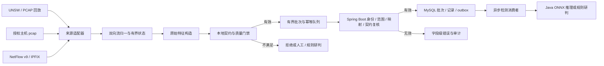

# 数据接入与特征提取模块开发设计

> 文档状态：开发设计与实施基线；本轮已实现 Spring 传感器管理/机器接入、严格 raw feature 契约校验、有限双向流聚合、NetFlow 模板生命周期和 M2 批次异步消费者（流引擎、特征构造、NetFlow 解码与回放尚未接入运行链路，实际接入完成度及待补缺口见 §1.4）。本文以仓库当前接口、数据库、功能模块文档及 `unsw-nb15-flow-v3.1` 导出契约为依据。模型契约如升级，以已审核且不可变的 manifest 和 `preprocessing.json` 为准。
>
> 范围：UNSW 离线回放、授权主机抓包、NetFlow v9/IPFIX 接入，规范双向流、提取模型原始输入、契约门禁、批次接入与影子验收。本文不设计前端 UI，不实现模型训练、不存储完整包、不执行真实防火墙动作，也不授权实网部署。

## 1. 目标、边界与当前状态

### 1.1 模块目标

将三类来源转换为有来源证明、版本明确、字段语义可审计的规范流记录；只有字段、单位、资产范围、来源映射和模型契约全部通过服务端校验的记录才可进入检测推理。不能满足契约的记录仍可按保留策略留痕并转规则/人工研判，但必须与可推理记录区分。

设计目标如下：

- 可重复：离线 UNSW/PCAP 回放使用固定样本、固定顺序和固定配置，产生可比较的规范输出。
- 可解释：每条记录可追溯到 sensor/collector、配置版本、来源映射版本、契约版本和接收批次。
- 有界：流状态、重排缓存、模板状态、重试队列和离线磁盘队列均有上限；达到上限时显式计数、告警和降级。
- fail-closed：授权、身份、来源、单位、字段语义、配置版本或特征验证不成立时，不进入模型推理，也不静默补造特征。
- 隐私优先：不保存完整包；默认只上报模型输入和必要的流时间/来源元数据，不上报原始地址、端口或应用载荷。

### 1.2 不在本模块中的职责

- 模型权重训练、阈值重选、在线学习、伪标签和自动模型替换；在线推理期间模型冻结。
- 根据检测分数直接封禁、修改路由、防火墙策略或执行 shell 命令。
- 通过主机传感器推断其不可见的交换式网络流量；普通主机采集只覆盖该主机实际能观察到的接口流量。
- 通过 TLS 中间人解密来取得 HTTP 方法；HTTPS 内容不可见时按契约的可缺失规则处理。
- 将 NetFlow/IPFIX 接入范围描述为全网覆盖。覆盖范围只能由已登记且有效授权的数据源及网络设备导出配置证明。
- 将主机限速、DDoS 缓解、终端行为识别或攻击阶段预测描述为流量特征分类能力。

### 1.3 仓库现状快照

| 能力 | 当前已核实状态 | 对本模块的意义 |
| --- | --- | --- |
| 数据源、来源映射 | `data_source`、`source_mapping` 表和管理 API 已有；映射登记为 draft，接入要求 approved 版本 | 复用实体和版本审批；本模块不得把 draft 当作可用映射 |
| connector 批次 | `POST /api/v1/machine/ingest/batches` 已实现规范化 JSON 批次、机器身份、明确 source-asset 配对、请求摘要幂等、批次/记录、审计和 outbox 同事务写入 | 该链路不是抓包、双向流构建、特征计算或完整单位校验 |
| connector 校验边界 | 当前校验来源范围、已批准映射、资产配对、JSON 结构和大小；不执行 mapping 转换或完整模型字段/单位 schema 校验 | sensor/collector 应走专用契约化入口或经明确扩展后的接入服务 |
| sensor 数据表 | `sensor_agent`、`sensor_config`、`sensor_health_window` 已在初始 schema 中 | 已复用；`V8__data_ingest_contract_and_sensor_batches.sql` 增加 sensor 批次追溯列，管理端登记/配置与机器端心跳、配置、流批次、健康窗口接口已实现 |
| Go sensor / NetFlow collector | 当前仓库未见 Go 进程实现 | Java 侧已提供有界双向流核心和模板生命周期；libpcap/Npcap 抓包适配及 v9/IPFIX UDP 解码仍需在独立采集进程中接入 |
| 异步消费者 / 推理 | M2 已声明 durable topic、批次队列、DLX、5 个 TTL 重试队列和死信队列；消费者按 `eventKey` 写 `consumed_message`，事务成功后手动 ack，并将 accepted 记录交给 M3 端口 | 默认关闭；未提供 M3 提交实现时显式重试后死信，不生成伪造推理结果；ONNX 版本一致性仍由 M3 验证 |

以上状态按本次写作时的工作区和设计文档核对。实现启动时再次检查代码、迁移和分支状态；规划表格或未提交文件不等于已交付运行能力。

### 1.4 实际接入完成度审查（2026-09-28，只读核对）

结论：按“实际接入项目使用”衡量，本模块未完成。后端“接收—校验—留痕”半段已贯通；“采集—特征构造—推理”半段未接入运行链路，且当前配置下任何传感器批次都不会进入检测。核对依据为 `backend/src/main/java/com/xyh/cybersecurity/ingest` 代码引用关系、Flyway 迁移与 `application.yml`；本轮使用 JDK 25 和独立 `DB_TEST_*` MySQL schema 完成后端验证，但未启用 RabbitMQ、真实传感器或在线推理。

已接入运行链路：

- sensor 管理登记与一次性凭据、机器端 heartbeat / config / health-windows / flow-batches 路由（`SensorManagementController`、`SensorIngestController`）。
- 服务端身份、source-asset 范围、活动配置、批准映射、序号 gap、幂等校验及 `FeatureContractValidator` 28 字段逐项校验；V8 批次追溯迁移。
- outbox relay 与 RabbitMQ publisher 已实现，但默认关闭（`OUTBOX_RELAY_ENABLED:false`）。

未接入或阻断实际使用的缺口：

| 编号 | 缺口 | 现状证据 | 影响 |
| --- | --- | --- | --- |
| G1 | 契约在线门禁关闭 | `feature-contract/unsw-nb15-flow-v3.1.json` 中 `onlineEnabled: false`；`SensorIngestService` 对每条记录追加 `FEATURE_CONTRACT_MISMATCH` 阻断 | 全部 sensor 记录 rejected，不进 outbox；根因为 `ct_state_ttl` codebook 未冻结（设计要求的 fail-closed，非缺陷） |
| G2 | 流处理组件为孤立类 | `BidirectionalFlowEngine`、`FeatureBuilder`/`FeatureWindow`/`CtStateTtlCodebook`、`NetflowDecoder`/`NetflowTemplateRegistry`、`UnswCsvReplayAdapter` 无生产代码调用、非 Spring bean，仅单元测试使用 | 双向流、CT 窗口、NetFlow 解码、回放均无运行入口 |
| G3 | 无采集进程 | 仓库无 Go sensor 工程及 libpcap/Npcap 适配 | 主机传感器无真实数据生产方 |
| G4 | NetFlow/IPFIX 接入端缺失 | 无 UDP 监听与 exporter allow-list；§5.2 四个 `/machine/collectors/*` 端点、collector 主体类型/权限、exporter/domain→资产绑定均未实现 | collector 来源不可用 |
| G5 | M3 推理实现未接入 | M2 已有 `q.ingest.batch.received` 消费者和 `consumed_message` 幂等台账；`InferenceTaskSubmitter` 尚无 ONNX 实现 | 打开消费者后，缺少 M3 时仅按重试上限转死信，不生成推理/告警结果 |
| G6 | 回放未贯通 | 回放适配器无入口；无“回放→后端校验→ONNX 与训练侧输出比对”的 parity runner | 阶段 2 离线一致性验收无可执行路径 |
| G7 | 契约冻结项未决 | §12 的 tie-break、迟到 watermark、`sload/dload` 等公式、HTTP method 计数口径无训练侧 golden fixture 对齐证据 | 在线特征语义不可证明与训练一致 |

后续补全顺序（按依赖关系）：

1. 从训练分支冻结 `ct_state_ttl` codebook 与 golden fixtures，发布新的不可变契约快照后再打开门禁；不原位修改 v3.1（G1、G7）。
2. 接入 M3 推理实现：在现有 `InferenceTaskSubmitter` 端口内按 batch + record 幂等调用 Java ONNX 并写检测结果；超时/版本不符显式失败，沿用 M2 重试与死信（G5）。
3. 为回放适配器提供入口，贯通后端链路并执行 ONNX parity 比对（G2、G6）。
4. 建立独立 Go sensor 工程，对齐 Java 流引擎与特征构造语义，避免双实现漂移（G2、G3）。
5. 实现 collector 注册/配置/批次/健康窗口端点、UDP 接收进程及 exporter 绑定迁移（G2、G4）。

各项完成后在本表更新状态与验证证据；未经验证的项不得标为已接入。

## 2. 架构与端到端数据流

### 2.1 主链路



Go 端的本地校验用于尽早发现错误，不构成服务端信任依据。服务端自行从机器主体查资产/数据源绑定、有效授权、活动配置、批准映射和模型契约；客户端提交的 `assetId`、`qualityStatus`、自动执行标志或风险等级不得覆盖服务端判断。

### 2.2 逻辑组件

| 组件 | 责任 | 不应承担的工作 |
| --- | --- | --- |
| Replay Adapter | 读取公开/许可允许的 UNSW 样本或离线 PCAP；适配为同一内部 packet/flow 输入 | 不把训练/测试资产上传到生产接口；不生成真实攻击流量 |
| Host Capture Adapter | 仅在获授权主机和批准接口上接收 pcap 包与时间戳 | 不扫描网络，不更改防火墙，不抓取批准范围外接口 |
| NetFlow/IPFIX Collector | 解析 exporter、模板、观测域、序号、字段和值长度；以授权数据源映射流记录 | 不把未授权 exporter 或未知字段猜成可信资产/单位 |
| Flow Engine | 双向五元组归一、流生命周期、方向统计、时间戳/字节/包计数和有界窗口 | 不保存完整 payload，不将单向视图伪装成双向完整流 |
| Feature Builder | 按冻结数据语义构造 28 个原始输入；写明单位、来源、质量信息 | 不重做 ONNX 中的派生特征、插补或类别编码 |
| Contract Gate | 校验契约版本、字段数/类型/单位/范围/可空规则及来源能力 | 不将缺失值静默补 0，不以客户端的通过标记取代校验 |
| Batch Uploader | 配置/序号/幂等键、限长序列化、退避重试、TLS 和凭据轮换 | 不持有用户会话，不调用任意 URL 或外部命令 |
| Spring Boot Ingest | 独立机器身份、资产/来源授权、映射版本、配置版本、摘要幂等、审计、持久化、outbox | 不信任传感器声明的资产、推理资格和统计计数 |

### 2.3 内部规范流记录

每个来源适配器先映射成同一语义对象，再运行特征和质量逻辑。示意字段如下，最终 DTO 必须与版本化 schema 一起评审：

```json
{
  "recordKey": "flow_01J...",
  "flowStartAt": "2026-09-27T03:10:00.000Z",
  "flowEndAt": "2026-09-27T03:10:02.150Z",
  "observedAt": "2026-09-27T03:10:02.210Z",
  "directionBasis": "initiator_to_responder",
  "sourceMappingVersion": "host-flow-v1",
  "featureContractVersion": "unsw-nb15-flow-v3.1",
  "features": {
    "dur": 2.15,
    "sbytes": 1200,
    "dbytes": 4200,
    "sttl": 64,
    "proto": "tcp",
    "service": "http",
    "ct_flw_http_mthd": null
  }
}
```

示例仅展示字段形态；真实可推理记录必须包含全部 26 个数值字段和 2 个类别字段。时间统一 ISO-8601 UTC；持续时长与观测时间不是同一概念。JSON 中 `ct_flw_http_mthd: null` 只表示契约允许缺失，接入层需按 manifest 将其映射为 ONNX numeric tensor 的 NaN；不得对其他字段采用同样处理。

- `recordKey` 在生成后随本地待发批次持久保存，重试不得重新生成。它应为不泄露五元组的 opaque ID；不得直接拼接 IP/端口或使用未加密的稳定五元组哈希。
- 方向以发起端到响应端定义，反向包累加到目的到源字段。首个观察方向一旦确定不能因后续反向包而翻转；NetFlow exporter 的方向字段只有经过 mapping 审核才可用于该语义。
- 原始地址、端口、接口名和包内容只在构建特征所需的受控内存范围使用。若以后案件证据确需保留 endpoint 标识，另行定义授权、最小化、伪名化和保留设计。
- 质量问题及来源不完整标记可以作为遥测附加字段，但 server 必须重新计算质量状态。客户端声称 `inferenceReady=true` 不产生授权效果。

## 3. 来源接入设计

### 3.1 UNSW 离线回放

- 以训练分支的冻结导出样本、训练侧字段定义和固定 golden fixture 为准；样本角色按文件内容和训练登记确认，不根据文件名推断训练/测试身份。
- 回放适配器按 `preprocessing.json` 的 raw input 顺序产生规范记录。版本变更、单位转换、大小写处理或空值处理都必须有显式映射和 fixture。
- 回放可以从 CSV/固定 PCAP 驱动；它用于确定性和契约验证，不证明真实流量域内有效性。
- 测试只读许可允许的数据。不得将锁定 holdout 用作反复调参或在线接入训练；训练计划规定的 holdout 使用规则继续有效。

### 3.2 macOS / Windows 主机传感器

- Go 实现跨平台核心；抓包接口采用 `gopacket`，macOS 依赖经过验证的 libpcap/BPF 能力，Windows 依赖安装并核验的 Npcap 驱动/服务。构建、包版本、签名和操作系统兼容矩阵在实施时固定。
- 不以普通用户权限无法抓包为由自动提权或静默安装驱动。安装说明必须列出系统权限、驱动依赖、卸载/撤销方法和版本；验证“具备采集能力”与“权限不足”两类结果。
- 系统抓包只绑定服务端下发的批准接口和受限过滤策略。接口/过滤配置结构化、allow-list 化；不接受远端任意 BPF、任意 shell 参数、插件或下载执行命令。
- 进程不应整体以 root / Administrator 运行；如平台能力要求高权限，限定到经验证的抓包组件/服务，并分离特征、上传和控制面权限。
- 抓包 handler 及时复制必要元数据后释放 packet buffer；内存中不保留完整 payload、不落 pcap 临时文件。TLS 内容不解密。
- 优雅退出先停止读取，按既定超时封闭流，标记不完整流并 flush 已完整、已验证批次；崩溃重启不得宣称恢复了丢失流。
- 主机传感器只上报所在机器可见范围。多个接口重复看见同一会话时，首期按批准配置界定观测点；未完成重复观测语义前不跨接口合并或宣称全量去重。

### 3.3 双向流键、方向和生命周期

建议基础流键由传感器/观测域、接口或明确观测点、传输协议和无方向排序的端点组成；端点包含地址和端口（非 TCP/UDP 协议须按协议身份定义）。原方向另存为 initiator/responder 用于特征方向。不同网络命名空间、VLAN/VRF 或 exporter observation domain 不得意外合并。

流处理约束：

1. 记录首个可观察方向及单调时间戳，后续反向报文依据同一双向 key 归档；只见一个方向时标记 `unidirectional`。
2. TCP FIN/RST、UDP/其他协议 idle timeout、最大寿命、截断包和 capture loss 的封流条件作为版本化配置。关闭原因进入质量遥测。
3. 使用单调时钟计算间隔、持续时间和本机 timeout；使用 UTC 事件时间生成 `flowStartAt/flowEndAt`。时钟回拨或时区异常不得产生负持续时间。
4. 根据明确上限维护流表、时间戳重排缓冲及内存上传队列。达到高水位时产生背压；到上限按既定策略丢弃或降级，增加丢弃计数，不可悄悄扩容至无界。
5. 包截断、首包缺失、反向观测缺失、乱序超过容许水位、流未正常结束或方向无法判定时，保留完整性标记；若这些情况使必需字段不可观测，该记录不得进入模型。
6. packet-level 去重与 record-level 幂等分开处理。当前 Java 核心按流保留最多 8192 个最近 packetId；窗口溢出时标记 `dedup_window_exceeded`，该流不能作为完整输入。批次重试不可重复持久化；窗口计数只能在 recordKey 判重后推进。

超时秒数、允许迟到时长、最大 flow 数、队列容量、批大小和采样参数必须通过目标主机基准测试设定。它们不是本设计文档给出的已验证性能承诺。

### 3.4 NetFlow v9 / IPFIX Collector

- 接收器绑定明确监听地址/端口与 exporter allow-list；只收已登记数据源授权范围内的 exporter。首期不包含 sFlow、SNMP polling、未登记 UDP 来源或自动网络扫描。
- 按 exporter identity + observation domain + template ID 维护模板，并实施 TTL、刷新、撤销和版本/字段清单记录；实现协议所规定的模板作用域与序号语义。
- 按 version、enterprise ID、information element ID、长度、值编码和单位读取记录。未知字段可以被跳过并作为 schema mismatch 计数；不得按相近名称猜字段。
- 只有映射经批准且字段语义/单位与规范契约等价时，才填入原始输入。来自 exporter 的地址归属以服务端 exporter/domain/interface 到登记资产的绑定为准，不信任数据报中客户端自报的 asset ID。
- NetFlow v9 和 IPFIX 的导出序号语义不同，实现必须按各自协议解析，不共享一个未经验证的序号算法。检测到 gap 时记录缺口区间和来源健康状态；若缺失可能改变窗口特征或时间完整性，受影响记录转人工/规则或拒绝推理。
- 缺失模板、模板过期、字段长度不合法或版本不支持：拒绝解码该记录并返回可诊断错误；模板刷新后从后续记录恢复，不反向猜解历史数据。
- collector 重启后不把空模板缓存当作有效模板；等待 exporter 重新发送模板。可在受控内存中维护模板，持久化模板 hash、最近刷新时间等健康摘要；不必持久化原始数据报。
- exporter 的 sampling、counter width、计数器重置、delta/absolute 语义、时间基准和 octet accounting 必须在 mapping 中登记。未知 sampling 或计数器单位时，禁止推理。

### 3.5 来源能力矩阵

| 字段组 | UNSW 回放 | 主机 PCAP | NetFlow v9 / IPFIX | 推理门禁 |
| --- | --- | --- | --- | --- |
| 时间、方向、协议、包数、字节数 | 原始记录可按样本字段读取 | 双向可见时可按冻结语义计算；字节统计层级须确认 | 常见计数器可提供，但 IE、采样和 byte accounting 必须审核 | 方向、时间、计数含义任何不一致则拒绝对应输入 |
| TTL (`sttl`) | 记录字段存在 | 可从 IP 头读取，但需确认源方向和截断情况 | 通常非标准必备字段，依 exporter/IE | 无值/单位不符不得填 0 |
| `sload/dload` | 训练记录值 | 需先冻结训练端公式、字节层级和零时长处理 | 仅在 IE/导出公式及单位等价时可用 | 不能仅凭名为 load 的字段接入 |
| `sloss`、`dinpkt`、`sjit/djit` | 按记录读取 | 可见性/重传定义/方向/样本数量影响计算；需与训练代码逐例对齐 | 通常不可直接获得或语义依赖厂商 | 未证明同义时 fail-closed |
| `tcprtt`、`synack`、`ackdat` | 按训练记录读取 | 必须看见握手相关双向包且从握手前开始；中途开始抓包不能补造 | 常见流 exporter 不提供握手阶段时延 | 缺字段即不可推理，不以 0 代替 |
| `ct_*` 近 100 条流统计 | 可用训练侧记录作基准 | 由传感器有界事件时间窗口实现 | 仅 exporter 明确提供等价统计字段才可用；通常不能从单条记录还原 | 窗口暖机、乱序和 gap 均影响完整性 |
| `ct_state_ttl` | 作为训练基准，但代码表需核实 | 需冻结状态类别、TTL 区间和编号 | 除非 exporter 给出完全同义值，否则不可映射 | codebook 未冻结时整个在线推理开关关闭 |
| `ct_flw_http_mthd`、service | 训练侧原始值 | 明文协议元数据可有限解析；TLS 不解密 | 通常不含 HTTP method；应用识别依赖 exporter | 可空规则只用于此字段；不得将未知服务随意映射成词表值 |

上述矩阵是能力门禁，不是每个来源均满足模型输入的承诺。同一来源可接受并留痕、但将全批次或部分记录标成 `manual_review` / `rejected`。不得以“支持 NetFlow/IPFIX”推导其数据均可进入 v3.1 模型。

## 4. 模型特征契约 `unsw-nb15-flow-v3.1`

### 4.1 契约身份与固定输入形状

- 当前 manifest：`unsw-binary-2026.09.0`，任务为 UNSW-NB15 分布的流量二分类，标签为 Normal / Attack；不输出攻击类别。
- `feature_contract_version`：`unsw-nb15-flow-v3.1`。输入包括 `flow_numeric` 的 26 列 float64 和 `flow_categorical` 的 2 列 string。每列索引/顺序必须逐项一致，不接受仅按 JSON 字段自然顺序序列化。
- 训练导出的 `model.onnx` 已嵌入派生特征、缺失值处理和类别编码。接入端只校验并提供 raw fields；禁止在 Go 或 Java 再执行 `rate`、比值、差值、插补或 ordinal encoding。
- 除 `ct_flw_http_mthd` 外，数值必须有限且非负；缺失、NaN/Inf、负值均 fail-closed。`ct_flw_http_mthd` 的缺失在 raw JSON 使用 null，经后端张量适配映射为 NaN，之后由模型图做训练时的中位数插补和缺失指示。
- `proto`、`service` 使用训练侧原始小写字符串词表；词表外取值由 ONNX 映射为 -1，接入层记录类别漂移。类别缺失与“有定义的未知服务值”必须按 manifest 区分。

### 4.2 原始输入字段、顺序、单位

下表顺序就是数值 tensor 的 index 顺序；后两项是 categorical tensor 的 index 顺序。字段语义和单位来源为 `training/windows-cuda` 分支对应导出 manifest、`preprocessing.json` 与 `src/cyber_training/v2/export.py`；实现时必须以实际审批通过的制品快照复核。

| index | 字段 | 类型 | 单位/取值 | 训练语义及实施约束 |
| ---: | --- | --- | --- | --- |
| 0 | `dur` | 数值 | 秒 | 流持续时间；非负，零值按模型允许范围处理，派生速率边界须遵循 ONNX 图 |
| 1 | `sbytes` | 数值 | 字节 | 源到目的方向字节数；计算的包层级/是否包含头部须按训练样本核实 |
| 2 | `dbytes` | 数值 | 字节 | 目的到源方向字节数；与 `sbytes` 使用相同字节口径 |
| 3 | `sttl` | 数值 | 跳数 | 源到目的方向 TTL；保持方向及观察点语义 |
| 4 | `sload` | 数值 | 比特/秒 | 源端速率；若由采集端计算，公式和 `dur=0` 行为须从训练代码及样例冻结 |
| 5 | `dload` | 数值 | 比特/秒 | 目的端速率；单位/公式同训练语义 |
| 6 | `sloss` | 数值 | 包 | 源端重传/丢弃包计数；仅使用可证明同义的捕获/导出定义 |
| 7 | `dinpkt` | 数值 | 毫秒 | 目的端包到达间隔；只有方向和统计口径与训练一致才可计算 |
| 8 | `sjit` | 数值 | 毫秒 | 源端抖动；公式、样本数不足和首包处理需 golden fixture 冻结 |
| 9 | `djit` | 数值 | 毫秒 | 目的端抖动；同上 |
| 10 | `tcprtt` | 数值 | 秒 | TCP 建连往返时间，训练描述为 `synack + ackdat`；非 TCP/不可观测不得臆造 |
| 11 | `ackdat` | 数值 | 秒 | SYN-ACK 到 ACK 的时间；必须观察到对应握手阶段 |
| 12 | `smean` | 数值 | 字节 | 源端平均包长；分母、包长口径和空方向规则需与训练实现一致 |
| 13 | `dmean` | 数值 | 字节 | 目的端平均包长；同上 |
| 14 | `ct_srv_src` | 数值 | 计数 | 最近 100 条完成流中同服务、同源地址的连接数 |
| 15 | `ct_state_ttl` | 数值 | 计数编码 | 状态与 TTL 区间的组合编号；不得自行编号，依赖训练侧冻结 codebook |
| 16 | `ct_dst_ltm` | 数值 | 计数 | 最近 100 条完成流中同目的地址的连接数 |
| 17 | `ct_src_dport_ltm` | 数值 | 计数 | 最近 100 条完成流中同源地址、同目的端口的连接数 |
| 18 | `ct_dst_sport_ltm` | 数值 | 计数 | 最近 100 条完成流中同目的地址、同源端口的连接数 |
| 19 | `ct_dst_src_ltm` | 数值 | 计数 | 最近 100 条完成流中同源/目的地址组合的连接数；方向和是否有序 pair 依训练定义冻结 |
| 20 | `ct_flw_http_mthd` | 数值，可空 | 计数 | HTTP 服务中具有 GET/POST 等方法语义的流数；严格沿用训练侧计数口径；唯一允许缺失字段 |
| 21 | `ct_src_ltm` | 数值 | 计数 | 最近 100 条完成流中同源地址的连接数 |
| 22 | `ct_srv_dst` | 数值 | 计数 | 最近 100 条完成流中同服务、同目的地址的连接数 |
| 23 | `spkts` | 数值 | 包 | 源到目的方向包数；不要把截断/丢包伪装成完整计数 |
| 24 | `dpkts` | 数值 | 包 | 目的到源方向包数 |
| 25 | `synack` | 数值 | 秒 | SYN 到 SYN-ACK 的时间；只有观察到握手才可构造 |
| 0 | `proto` | 类别 | 小写字符串 | 传输协议；使用训练词表及 ONNX OOV 规则 |
| 1 | `service` | 类别 | 小写字符串 | 应用服务；词表含 `-`。未识别、不可见和缺失须按训练映射分别处理 |

### 4.3 窗口统计与难冻结字段

七个有最近 100 条连接语义的统计值为 `ct_srv_src`、`ct_dst_ltm`、`ct_src_dport_ltm`、`ct_dst_sport_ltm`、`ct_dst_src_ltm`、`ct_src_ltm` 和 `ct_srv_dst`。基线实现要求：

- 窗口作用域为单一 sensor 身份（或单一已批准 exporter observation domain）；多传感器不得共享状态或互相补数。
- 事件时间排序；当前即将输出的已完成双向流计入窗口，再计算该流对应计数；窗口未满 100 条时不送模型。
- 去重后才推进窗口。配置/契约切换、进程重启、序号 gap、无法界定的迟到流或窗口状态丢失时重新预热；窗口不满或顺序不可信期间禁用模型推理。
- 重排 watermark 和迟到处理必须定量冻结并在训练 golden fixture 上验证。过迟记录不回写已生成特征，也不以处理到达顺序冒充事件顺序。
- 每个计数的 group key、服务归一化、地址方向、端口方向、重复流口径都要逐字段列入实现规格，不以一个泛化 `ct_*` 计数器替代。

`ct_state_ttl` 在导出定义中仅说明为“按状态与 TTL 区间统计的编号”；当前实现未臆造 codebook，`FeatureContract.onlineEnabled=false`，因此 v3.1 传感器批次会留痕为 rejected 且不进入 outbox。在线推理启用前必须从训练生成过程、数据字典和 golden samples 确认合法状态、TTL 分桶边界、编号及异常值规则，随后以新的不可变契约快照打开门禁。

`ct_flw_http_mthd` 仅能使用必要的协议元数据判断 HTTP method，不在磁盘留存请求行或 body，不做 TLS 解密。训练侧说明指出它是 nullable：可观测且具有方法语义时按冻结公式赋值；不可观测时传 null。方法解析失败不能冒充“没有 HTTP 方法”并填 0。

### 4.4 映射、单位和版本升级

- 每个 `source_mapping` 必须以不可变的 `sourceSchema + mappingJson + mappingVersion` 表示；批准后不得原位修改。字段含义、单位、字节口径、时间基准、方向、枚举归一、nullable 和 exporter sampling 均进入映射审核。
- 来源记录只提供数值但单位不明、毫秒/秒不明、byte/bit 不明、累计值/单流值不明或导出器采样未知时，拒绝推理；不得靠数量级猜测单位。
- 对数值字段先校验原始 JSON 类型、有限性、非负范围与契约 nullable，再按显式版本执行必要的确定性单位转换。转换系数、精度和舍入规则写入 mapping version 并由样例验证。
- 对模型输入字段的增加、删除、顺序、类别词表、预处理、派生语义或空值变化必须升级 `featureContractVersion`，更新 manifest、Java 输入适配、Go contract registry 和接口文档；不得原位改写 v3.1。
- ONNX 不可用、模型版本/contract 不一致或执行超时必须显式失败。禁止静默退回旧模型或用不同字段排列继续推理。

## 5. 机器身份与接口契约

### 5.1 主机 sensor 身份

- 由管理员在平台登记待安装 sensor、目标资产、操作系统、能力、授权期限和批准配置；注册不能由未知客户端自行声明资产关系。
- 注册凭据一次性签发且高熵、短期有效；注册成功后绑定服务端 `sensor_agent.id → asset_id`，凭据只保存在受控密钥系统引用/不可逆摘要中，并可轮换、吊销和限期失效。
- `sensor_agent` 是 sensor 专用机器主体；不使用浏览器 Cookie/CSRF，不复用 connector token，不授予 `machine.ingest.submit` 以外未批准权限，也不持有响应适配器凭据。
- 机器请求使用 TLS、request ID、时间窗和受限批次；服务端以 credential resolve 主体，不采信 URL 或 body 中传入的 `sensorId/assetId` 来确定授权。
- 注册 body 可以携带 agentKey、安装 nonce、平台版本和能力声明作匹配；资产绑定只能由管理员预登记状态决定。

### 5.2 机器 API（本轮已实现）

所有机器端点使用 `/api/v1`、独立认证过滤链和统一 `ApiEnvelope`。下表中 sensor 管理与机器上报路由已在 Spring Boot 中实现；collector 注册/解析仍保留为后续独立进程边界：

| 方法与路径 | 用途 | 关键校验 |
| --- | --- | --- |
| `POST /api/v1/sensors` | 有权限管理员登记 sensor、批准首个配置并一次性换取 30 天设备凭据 | `sensor.manage`、资产有效授权、数据源 active、结构化配置 allow-list、agentKey 唯一 |
| `POST /api/v1/machine/sensors/{sensorId}/heartbeat` | 心跳和版本/能力摘要 | sensor identity 必须与路径一致；已吊销主体拒绝 |
| `GET /api/v1/machine/sensors/{sensorId}/config` | 获取签名配置 | 只返回该 sensor 当前批准配置、contract、接口 allowlist、过滤策略、窗口/队列参数和有效期 |
| `POST /api/v1/machine/sensors/{sensorId}/flow-batches` | 批量提交规范流 | 身份绑定资产；有效 config/序号/映射版本/合同；服务端重新做字段级质量检查 |
| `POST /api/v1/machine/sensors/{sensorId}/health-windows` | 提交健康窗口 | 窗口非重叠/幂等、资源值范围合法、摘要中不含凭据或 payload |
| `POST /api/v1/machine/collectors/register` | 登记受控 NetFlow/IPFIX collector 主体 | 只由管理员预先登记的 collector 和授权来源范围能注册 |
| `GET /api/v1/machine/collectors/{collectorId}/config` | 获取 exporter allowlist、dataSource、授权资产绑定和批准 mapping | 配置有版本、有效期、签名和明确采集范围 |
| `POST /api/v1/machine/collectors/{collectorId}/flow-batches` | 提交已解析且映射的 flow record batch | collector 身份、来源、exporter/domain/template/mapping 绑定及序号检查 |
| `POST /api/v1/machine/collectors/{collectorId}/health-windows` | 报告模板、缺口、解码错误及队列健康 | server 校验主体和时间窗，客户端的错误统计仅作遥测 |

注册接口之后的 sensor / collector 上报不得接受远端命令、插件、任意配置下载地址或凭据明文。

### 5.3 批次头与记录体

批次至少包含 `batchKey`、`idempotencyKey`、`configVersion`、单调 `sequence`、`observedAt`、`sourceMappingVersion`、`featureContractVersion` 和 `records[]`。批次级字段决定批次授权/契约上下文；若单条来源映射不同，则每条也带 mapping version 并由 server 检查与登记值一致。

每条记录包含 opaque `recordKey`、`flowStartAt`、`flowEndAt`、方向基础、规范 raw features。默认不含 `assetId`；sensor 绑定、exporter/domain mapping 在服务端解析资产。需要按源接入现有 connector DTO 时，不应把 connector 规范化 payload 直接当作契约通过证据。

- 每个 batch 的序号严格按主体和配置版本作用域；同序号、同 request digest 返回原 receipt；同序号异内容返回 `409 SEQUENCE_CONFLICT`。
- 顺序出现 gap 时持久化缺口事实、健康指标和审计摘要。不得静默把后续 batch 的 sequence 重新编号。受 gap 影响的近 100 流统计需要预热；未受影响且每条记录自足的记录也要按来源映射明确判定，不能仅由客户端请求绕过。
- 请求摘要使用规范序列化后 SHA-256，绑定契约、配置、mapping、序号及所有记录字段；同幂等键异摘要冲突。数组记录顺序是语义数据，规范 JSON 键顺序但不能重排记录数组。
- 复用当前全请求上限 1 MiB、最多 500 条和单条规范 JSON 64 KiB 的服务端上限作为首版建议；压测后可调低/经评审调整，不能放宽为无界输入。
- 连接断开后 sensor 仅在本地加密、有限、过期队列内缓存已经形成的批次；队列满明确丢弃/降级并上报丢失量，不无限堆积。重试采用指数退避和 jitter，尊重服务端 Retry-After。

### 5.4 错误分类

错误响应继续使用 `{code, message, requestId, details}`；details 只返回 recordKey、field、expected/actual type-unit 等脱敏信息，不返回完整 packet 或秘密。

| 错误码建议 | HTTP | 处理语义 |
| --- | ---: | --- |
| `MACHINE_IDENTITY_REJECTED` | 401/404 | 凭据无效、过期、撤销或主体类型不允许；避免借错误区分越权资产存在性 |
| `SCOPE_OR_ASSET_REJECTED` | 403/404 | 来源、exporter 或绑定资产不在服务端主体授权内；拒绝整条越权记录并审计 |
| `CONFIG_VERSION_STALE` | 409 | 配置不存在、失效或已被替换；sensor 拉取新配置后重新生成批次 |
| `SEQUENCE_CONFLICT` | 409 | 同主体同 sequence 对应不同规范摘要 |
| `IDEMPOTENCY_CONFLICT` | 409 | 同 idempotency key 对应不同批次内容 |
| `MAPPING_NOT_APPROVED` | 409 | mapping 未批准、被禁用或不属于该 data source |
| `FEATURE_CONTRACT_MISMATCH` | 422 | contract 版本未登记/未激活、顺序或数据类型不兼容 |
| `REQUIRED_FIELD_MISSING` | 422 | 非 nullable 字段缺失/null 或来源证明不足 |
| `FEATURE_VALUE_INVALID` | 422 | NaN/Inf/负数/单位范围或枚举表示非法 |
| `FLOW_RECORD_INVALID` | 422 | 时间区间、方向、flow key 或记录 schema 不合法 |
| `NETFLOW_TEMPLATE_MISSING` / `NETFLOW_TEMPLATE_EXPIRED` | 422 | 此 exporter/domain 无可用模板，不猜测记录边界和 IE |
| `EXPORT_SEQUENCE_GAP` | 202/422 | 记录 gap 事实；是否接收行或仅标记需按受影响契约范围决定 |
| `BATCH_TOO_LARGE` / `RATE_LIMITED` | 413/429 | 客户端分批/退避，不能无上限重试 |
| `INGEST_UNAVAILABLE` | 503 | DB/outbox 暂时不可用，安全重试；服务端必须原子提交或无批次副作用 |

接口错误必须稳定、可重试性明确、携带 request ID；模型契约或单位失败不得返回推理成功。

## 6. 后端持久化与异步交接

### 6.1 优先复用现有结构

| 现有表 | 本模块用途 | 设计约束 |
| --- | --- | --- |
| `sensor_agent` | sensor 身份及 asset 绑定 | 凭据仅保留引用/摘要；status 和授权变化审计 |
| `sensor_config` | 批准接口、过滤策略、窗口、contract 和采样配置 | 配置不可原位改写；采用 version 和状态迁移 |
| `sensor_health_window` | 每个 sensor 的 seen/emitted/dropped/queue/CPU/memory/error 摘要 | health 不代替服务器验权和记录校验 |
| `data_source` | UNSW、host sensor、NetFlow v9、IPFIX 等登记来源 | source_type 与 schema version 应区分协议/来源版本 |
| `source_mapping` | exporter/source schema → 规范字段、单位和方向转换 | mapping 版本只增不改，必须批准 |
| `ingest_batch` | 幂等批次事实、请求摘要和处理状态 | 同事务写记录、审计和 outbox；重试不重复计数 |
| `ingest_record` | 规范流 raw feature、事件时间和服务端质量结论 | 不存完整包；保存 contract version / quality issues 可追溯 |
| `outbox_event` | 确保接入事务和后续检测任务最终一致 | 至少一次投递；消费者以 batch/record 幂等 |

目前 `ingest_batch` 已有 `(data_source_id, idempotency_key)` 唯一约束和 `request_sha256`；`ingest_record` 已有 `(batch_id, source_record_key)` 唯一约束。实现时应通过版本化 Flyway 向前迁移，不重置或重建用户数据库。

### 6.2 建议最小兼容迁移

若当前字段不足以表达 sensor 与 collector 批次，仅新增 nullable 的追溯列以兼容现有 connector：

- `ingest_batch.sensor_id`（仅 sensor 来源可填，外键 `sensor_agent`）。
- `ingest_batch.machine_client_id`（仅 collector/现有 machine client 来源可填，外键 `api_client`）；collector 必须是专用主体类型，不能冒充 connector。
- `ingest_batch.config_version`、`sequence_no`、`feature_contract_version`；必要时增加 `source_protocol_version` 或 `exporter_sequence_from/to`，但只有当批次字段实际承载这些内容才增加。
- `UNIQUE(sensor_id, config_version, sequence_no)` 与适用于 collector machine 主体的唯一序号约束；旧 connector 记录为 NULL，不与新序号冲突。数据库对 NULL 唯一索引的具体行为须在 MySQL 8 目标版本验证。
- 若按批次已能确定 `source_mapping_version`，可增加 nullable batch 字段以便快速审计；记录仍保留已有 `ingest_record.mapping_version`。不要重复持久化同一事实后造成相互矛盾。
- `ingest_record` 可增加 `feature_contract_version` 或来源完整性标记，仅在单批中可能混合合同/完整性状态且批次级字段不足时采用；质量问题字段优先承载字段级拒绝原因。
- 新权限迁移为 sensor 注册/上报和 collector 上报分别授权。collector 扩展 `api_client.client_type` 前先核对 V4 CHECK constraint；采用专用 permission 和 source/asset pair，不扩大 `connector` 的既有权限。

迁移必须是前向、可审阅、兼容既有 connector 数据的 Flyway 变更；不运行数据库写入、不改 init SQL、不在本文任务中创建迁移。测试验证空库 V1 到新版本、既有数据升级、唯一键并发冲突及旧 connector 行兼容。

### 6.3 事务和状态

1. 验证 machine identity、主体类型和到期/撤销状态。
2. 从服务端授权关系解析 source/asset；验证资产 active、授权当前有效、source active、sensor/config 与 mapping 获批。
3. 规范化请求并计算摘要；以幂等键和 sequence 查重，处理完全重放、内容冲突和并发竞争。
4. 对每条记录执行服务端 schema、source capability、contract、单位、完整性和质量校验；按结果分别记录 `accepted` / `manual_review` / `rejected`，不能把本地通过标志计入服务端 accepted。
5. 在同一事务写入 batch、record、字段级问题、范围审计和 outbox；任一步骤失败要么全回滚，要么由明确的批次状态记录可重放错误，不能留下“已接收但无事件”的半状态。
6. outbox relay 至少一次派发；检测消费者用 batch ID + record key 幂等。重复事件不重复生成 inference request / alert。消费者故障进入重试与死信，保持 MySQL 为事实源。

目标状态可复用 `received → validating → processing → completed | completed_with_errors | rejected`。HTTP 接收成功只代表批次已持久化，不代表记录都可推理或已完成模型判定。

## 7. 数据保护、可靠性和降级

- 只接受授权被动数据、公开基准或预制 PCAP；collector/exporter 范围明确登记并经授权。授权在注册、配置拉取和批次接收时均检查当前状态/有效期。
- 机器凭据高熵、一次显示、独立轮换/吊销、按 sensor 或 collector 最小权限签发；数据库仅存安全引用或不可逆验证材料。连接器、sensor、collector、response adapter 类型和权限彼此隔离。
- 不在日志、审计 details、异常、sample 或 test fixture 中输出密钥、地址明文、TLS 内容、完整报文、未脱敏个人信息或可复用身份凭据。
- 内存只保存计算所需的包元数据、流表、有界最近流窗口、短期模板和队列；队列磁盘落地若启用需加密、设 TTL、限空间、权限隔离、启动清理规则和审计。
- 确认 capture drop、queue overflow、template expiry、exporter gap、clock skew、field rejection、batch lag 都能被看到。只汇报成功记录而隐藏丢弃会造成错误覆盖率结论。
- 失联时不扩大采集范围、不执行响应动作、不更换模型；按本地有效签名配置在短期内继续被动记录或安全停止。超期配置禁止继续上报/推理。
- 恢复后按原 idempotency key/request digest 安全重试；超过本地队列 TTL 或 gap 过大，输出数据丢失摘要并重新预热 `ct_*` 统计。
- 任何来源单位不确定、契约版本未知、ONNX 不可用或 schema mismatch 均进入 `manual_review` / `rejected`，不得无提示 fallback 到旧特征或旧模型。

## 8. 分阶段开发计划

### 阶段 1：冻结数据与模型契约

交付：不可变 v3.1 contract 文件引用、字段语义/单位/公式表、类别词表、HTTP nullable 规则、CT codebook、来源能力矩阵和 golden fixtures。

工作项：

1. 对照已审查 model manifest、`preprocessing.json`、export code、UNSW 字段字典和固定训练样本，检查 numeric/category 顺序、类型、单位、合法范围、OOV/null 规则。
2. 明确包长字节层级、load/mean/inter-packet/jitter/loss 公式、TCP handshake 定义、服务分类、方向和 event-time 窗口边界。
3. 补齐 `ct_state_ttl` 状态类、TTL 分桶边界和编号来源；为每种合法组合和异常组合建立 golden sample。
4. 明确七个 100 流字段是否包含当前流、相同事件时间的 tie-break、迟到水位、重启暖机、去重和 scope；结果与训练侧记录一对一核对。
5. 固定 HTTP method 计数语义，并确认 null 映射到图内缺失路径；用没有 HTTP、明文 HTTP、截断请求和 TLS 记录覆盖 fixture。
6. 明确模型输入顺序与 Java ONNX tensor adapter 的固定数组布局，检查 contract version 和已批准的模型版本。

退出门槛：任何模型必需字段仍没有明确语义/单位/计算式/codebook 时，不启用该 contract 的在线推理；允许进入回放或仅记录开发。

### 阶段 2：规范流、回放适配器与离线一致性（核心校验已交付）

交付：版本化规范 DTO、服务端 schema validator、固定字段顺序校验、拒绝原因结构化持久化、可重放的 Java 单元测试，以及只读 UNSW CSV raw-field 回放适配器。适配器只读取 26 个数值字段和 2 个类别字段，标签仅作为回放旁路信息；不执行插补、派生或类别编码。离线 PCAP adapter 与 ONNX parity runner 仍由训练交付目录接入。

验证：原始输入 28 项顺序/类型/单位正确；两份同输入重复回放得到同摘要；负值、NaN/Inf、缺字段、错误单位、未知合同均有预期错误；ONNX Runtime Java 概率与训练侧输出按已批准容差一致，阈值分类决策一致。回放不可读取/污染 holdout。

### 阶段 3：Go 主机 sensor 与双向 flow engine

交付：Java 侧已补充可复用的事件时间窗口和 raw Feature Builder：每个 sensor 独立维护最近 100 条完成流，迟到/重复记录被拒绝，窗口未满不构造推理输入；七个 LTM 计数按明确 group key 计算。`ct_state_ttl` 只有显式冻结的状态/TTL codebook 才可编码，缺失或未命中时 fail-closed。Go 模块边界、pcap 适配、封流规则、有界队列、机器身份配置客户端及健康 telemetry 仍需在独立 sensor 工程完成。

验证：macOS arm64 与 Windows 目标系统分别做构建、依赖、权限、安装/卸载和离线 PCAP 测试；方向翻转、单向流、乱序、重复包、TCP FIN/RST、UDP idle、进程重启、队列满与抓包丢包场景都可观察。

### 阶段 4：NetFlow v9/IPFIX collector

交付：Java 侧已补充受控 NetFlow v9/IPFIX 二进制解码器：按 exporter/observation domain/template ID 查找模板，支持模板学习、刷新/过期、enterprise IE、定长字段解码和协议序号缺口标记；未知 IE 保留为不透明字段名，不猜测模型语义。导出源/观测域登记、版本化 mapping、健康窗口持久化和 collector 进程仍需接入控制面。

验证：模板 refresh/delete/expiry、未知 IE、enterprise IE、截断长度、v9/IPFIX 各自 sequence 规则、counter wrap/reset、采样不明、exporter spoof、来源/资产越权及模板重启预热。不符合契约记录可以被保留并拒绝推理，不能猜字段。

### 阶段 5：Spring 接入、outbox 和授权主机影子验证（后端核心已交付）

交付：独立 machine auth 路由、授权 sensor 登记与一次性凭据、批准配置读取、心跳/健康窗口、sensor 批次幂等/序号、防重放、服务端范围及 field contract 校验、V8 前向迁移、字段级拒绝记录、审计和 outbox 写入；新增默认关闭的有界 outbox relay，支持 `pending/failed → published`、指数退避和死信上限。RabbitMQ publisher 使用 durable topic exchange `cyber-security.ingest.events`（可配置），消息带 `schemaVersion`、稳定 `eventKey`、`eventType` 和 `payload`，并等待 publisher confirm、检查 unroutable return。M2 新增 V10 `consumed_message`、`q.ingest.batch.received`、`cyber-security.dlx`、死信队列和 1..5 次 TTL 重试队列；消费者手动 ack，只有事务提交后才确认原消息，重复 eventKey 只交接一次。必须显式设置 `OUTBOX_RELAY_ENABLED=true`、RabbitMQ 主机/端口/vhost/用户名/密码后才连接 broker；M3 推理提交实现尚未接入，缺失时 fail-closed 并在上限后进入死信。collector enrollment 和单台主机影子运行仍未启用。

先用 UNSW/离线 PCAP fixture 贯通后端，再于用户明确授权的单台主机执行被动影子采集。通过前不触发任何防火墙动作，不启用自动处置，不宣称实网有效性。

## 9. 测试与验收矩阵

| 类别 | 必测场景 | 通过条件 |
| --- | --- | --- |
| 契约字段 | 28 项完整正确输入、每个必需字段缺失/null/字符串、NaN/Inf/负值、单位秒/毫秒/bit/byte 正反例 | 服务器按字段名返回稳定结果；必需不合格记录绝不调用模型 |
| 顺序与模型一致性 | 故意交换两个输入列、修改 contract version、OOV category、HTTP null | 顺序不匹配被拒；OOV 按 manifest 映射并记漂移；null 仅允许于 HTTP 字段；ONNX label/score 一致 |
| Flow Engine | 正反向包、方向首包缺失、IPv4/IPv6、VLAN、fragment/truncation、TCP 生命周期、UDP timeout、重传和双接口重复观察 | 正反方向计数与 golden fixture 完全相同；不完整观测不会伪装完整 |
| Event time / CT | 99、100、101 条窗口边界；当前流是否计数；相同 timestamp tie-break；迟到、重排、重复、重启 warmup、sequence gap | 各 CT 字段逐项与冻结训练 fixture 一致；warmup 和 gap 期间不送模型 |
| HTTP/service | 明文方法、请求截断、非 HTTP 文本、HTTPS/TLS、service 未知值、null/0 区别 | 不保存 payload、不做 TLS 解密；可空处理只按 manifest，服务枚举不猜测 |
| NetFlow/IPFIX | v9/IPFIX template 学习/刷新/过期/删除、未知 IE、长度不匹配、enterprise field、sequence gap、采样/计数器重置 | 协议错误明确、影响窗口时推理 fail-closed、状态可观测，未知语义不映射 |
| 身份/授权 | 无效/撤销/过期 machine credential，跨 asset/source/exporter，body 冒充 assetId，sensor URL id 不匹配 | 请求拒绝、越权对象不泄露、无跨范围入库，产生脱敏安全审计 |
| 配置/映射 | stale config、未批准或错误 data source 的 mapping、sensor 被撤销、授权到期 | 未授权或版本不符拒绝；approved 映射版本可追溯且不可变 |
| 幂等/并发 | 同批同键重放、同键异 payload、相同序号竞态、相同 recordKey 重复、网络中断后重试 | 同内容返回原 receipt；异内容冲突；不重复计数/写入/推理 |
| 事务/outbox | DB 在写 batch/record/outbox 不同阶段失败，relay 重发、消费者重启、死信 | 不留不一致半状态；消费至少一次但业务效果幂等；失败有可审计恢复信息 |
| 容量/降级 | 抓包突发、flow table 满、队列满、网络断开、服务端 429/503、磁盘队列到 TTL | 内存/磁盘有上界，drop/lag 明确上报，退避不风暴，不执行动作 |
| 跨平台 | macOS libpcap/BPF 权限与 Windows Npcap 安装/服务/权限 | 可复现构建、权限失败清晰、停止/卸载恢复，不静默提权 |
| 隐私与安全 | 日志、错误、队列、数据库、测试夹具扫描 payload/凭据/地址明文 | 无完整包、密钥或超范围个人/网络数据；错误 details 已脱敏 |

自动化使用公开 UNSW 样本及离线 PCAP/协议 fixtures；不向真实网络注入流量，不执行利用或扫描，不在未授权目标安装 sensor。

## 10. 影子运行、性能基线与退出条件

在用户明确授权的测试主机以被动方式运行，选择明确批准接口和时段。第一轮将结果只写入隔离影子数据源，不触发 firewall adapter，不影响网络转发。记录并分析：

- 观测流量覆盖和双向完整度；有效流/全部结束流比率；字段缺失率、字段拒绝率和 manual-review 比率；来源、接口和配置版本。
- packet capture drop、collector sequence gap/template miss、flow queue max/depth、磁盘队列占用和恢复时间。
- 端到端 P50/P95/P99、CPU、RSS、网络上报量、数据库写入延迟及 outbox backlog。
- 28 个输入分布与 UNSW reference 的差异、类别 OOV、nullable HTTP 比例、CT 窗口状态及模型预测分布。
- 人工复核样本中的域差异、误报/漏报和其可见范围。回放通过不能替代这些证据。

阈值须先在目标主机、实际接口和批准负载上测基线后确定；本文不预设丢包率、CPU、内存或延迟数值。质量不足、持续缺字段、域差异不可解释、授权失效、丢失无法重建或模型输入分布越界时停止推理，保留可审计的拒绝/人工路径。

退出条件：对每类来源单独出具可推理字段证据；训练 golden parity 通过；拒绝/重试/幂等测试通过；目标 OS 权限和性能基线通过；授权 scope、审计、凭据吊销、数据保留通过；影子运行经人工评审。以上仅授权继续方案评审，不自动批准真实动作或扩大资产范围。

## 11. 失败模式和处理原则

| 失败模式 | 用户可见结果 | 安全处理 |
| --- | --- | --- |
| sensor / collector credential 撤销或授权到期 | machine request rejected，采集状态变为失效/离线 | 拒绝新批次；不接受本地旧授权扩大范围 |
| source mapping 或 config stale | 明确版本错误和 requestId | 拉取已批准版本后重新构造批次；不以最新 mapping 静默解释旧 payload |
| required field 不可观测 | field-level `manual_review` 或 `rejected` | 不造值、不推理；保存最小原因并统计来源缺口 |
| codebook / service semantics 未冻结 | contract 置 disabled | 仅允许回放研究；不得打开在线推理 |
| capture queue / flow state 饱和 | drop、queue peak、降级状态可查询 | 有界丢弃/背压；无界内存和静默采样禁止 |
| 模板 miss / exporter sequence gap | collector health window 和受影响时间范围标记 incomplete | 不猜 template；窗口特征受影响时重新 warmup 或拒绝推理 |
| DB/outbox 短时不可用 | 503 和安全重试 | 保留原幂等摘要；过期队列报告 gap，不伪造成功 receipt |
| Java ONNX timeout / contract mismatch | inference request failed/rejected | 显式失败，不回退旧模型或将记录标为正常 |
| 两来源对同一资产重复观察 | source/observation-point 标识显示重复 | 首期分别保留，不盲目合并 CT 或覆盖来源证据 |

## 12. 术语、默认值与待决项

| 项目 | 基线决定 | 待实现前确认 |
| --- | --- | --- |
| 流方向 | initiator → responder 对应 `s*`，反向为 `d*` | UNSW 原始导出对 initiator 定义、NetFlow exporter 方向映射 |
| CT 窗口 | 每 sensor 最近 100 条完成流、事件时间排序、当前流计入，未满不推理 | tie-break、迟到 watermark、sensor 多接口 scope、每字段 group key |
| `ct_state_ttl` | 禁止自编编号 | 训练侧完整状态/TTL 分桶 codebook 和 golden fixture |
| `ct_flw_http_mthd` | nullable 唯一；缺失传 null，不补零 | method 解析时点/次数、混合 HTTP/HTTPS、训练侧聚合窗口 |
| `sload/dload` 等推导字段 | 字段单位以 manifest 为准 | 完整计算公式、字节口径、舍入/零时长行为 |
| NetFlow/IPFIX 授权模型 | exporter/domain 与 source/asset 明确绑定 | collector 主体字段及协议特定序号存储格式 |
| sensor 批次上限 | 先沿用 connector 1 MiB/500 条/64 KiB 单条建议 | pcap 流速基准后决定合理批量/时长 |
| SLA 和灰度阈值 | 不预设 | 测试主机 baseline、可接受丢弃率、延迟和资源预算 |

上述待决项不得在实现过程中由开发者任意猜定。特别是 `ct_state_ttl` codebook 未冻结时，不得以相似值或类别序号替代。

## 13. 相关文档与证据

- [项目 README](../README.md)：目标、可见范围、技术基线和模型边界。
- [功能模块设计](功能模块设计.md)：当前模块实现状态、sensor/流特征/规范化质量门禁规划。
- [接口设计](接口设计.md)：机器身份、当前 connector 批次契约、传感器目标接口和统一错误 envelope。
- [数据库设计](数据库设计.md)：`sensor_agent`、`sensor_config`、`sensor_health_window`、`data_source`、`source_mapping`、`ingest_batch`、`ingest_record`、`outbox_event` 的字段与约束。
- [模型训练计划](模型训练计划.md)：数据切分、模型导出、ONNX 图内预处理、锁定评估、Java 运行时和训练交付状态。
- [项目详细设计](项目详细设计.md)：总体模块关系、安全边界和运行流程。
- 当前契约证据（`training/windows-cuda` 分支）：`docs/v2/evidence/export-20260927-1912-model_manifest.json`、同目录 `export-20260927-1912-preprocessing.json`、`src/cyber_training/v2/export.py`。这些文件属于训练分支，提交/发布时应记录实际 manifest SHA-256，并确保文档对应经过审批的 immutable artifact。

本文只定义接入与特征提取模块的实现依据。任何新增源类型、字段、单位、模型能力、真实资产或动作权限均为范围变化，需先更新契约与授权设计。
