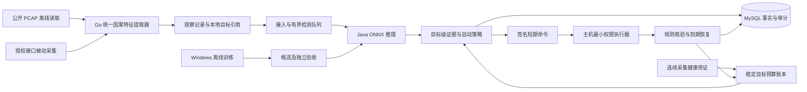

# 项目详细设计

版本：host-guard v5，更新于 2026-10-05。P1/P2 已完成并收口；本文件描述 P3—P8 的目标系统，实现差距见[现状与迁移](现状与迁移.md)。观测格式沿用 rc.2，新决策、评价和健康证据版本见[统一契约](检测与处置契约.md)。

## 1. 产品目标与能力

首版必须在至少一个有独立验收证据的攻击家族上完成“真实模型输出 → 自动策略 → 真实防火墙 → 自动恢复”，且模型相对仅规则有可量化收益。仅有离线准确率或固定规则演示均不算完成目标。

能力按 `(platform, adapterVersion, addressFamily, protocol, direction, attackFamily, featureProfile)` 注册，独立取得 `research / alert_only / lab_auto / authorized_auto / suspended` 等级。未支持类别不阻塞已验证能力；当前 v5 全部为 research。

当前 P3 收敛为 HTTP/80 入站的 connection_abuse，包含 slowloris 慢头部与 slowhttptest 慢请求体两种行为，使用 flow-prefix-v1。来源域与行为分开登记，两行为及支持来源分别验收。SSH 登录失败、加密应用漏洞利用、恶意内容不是仅凭头部统计可承诺的能力；DoS 标签不意味着能解决上游链路饱和。新增任务范围另行版本化，不从历史类别名称推定支持。

## 2. 根因与裁决

| 旧限制 | v5 裁决 |
|---|---|
| 围绕历史 UNSW 字段和响应端挑数据 | 按主机观测和攻击行为定义输入 |
| 100 条完成流暖机及约 61 秒释放等待 | 正在进行的流和因果时间窗；完整流用于复核 |
| 规范记录没有执行目标 | 统计特征与受保护目标引用分开 |
| 同资产不同对端合并、计数抬高风险 | 执行证据绑定对象；快照去重，排序和阻断资格分开 |
| 训练等待全部影子门禁 | 开发数据合格即可实验；发布再验收整链 |
| 最后才开发执行器 | P1 平台探针已收口；P4/P5 分别完成后端与生产适配器 |
| 改时长或身份后称为新独立样本 | 完整 parent、共同早期轨迹及来源上下文一起归组 |
| 活动结束就清空动作预算 | 稳定真实目标账本跨活动，持续健康与到期后冷却均证明后恢复 |
| 每个统计桶重置攻击起点 | 原始活动起点固定，机会覆盖和首次响应时效分别计算 |

## 3. 总体架构

控制面保持 Spring Boot 模块化单体。首版只支持本机 ONNX，远端推理不列交付依赖。RabbitMQ 承担已持久化观察/决策通知，MySQL outbox 保证可靠发布；队列拥堵不得使过期证据产生新阻断。Redis 不承担事实、唯一幂等或恢复。

部署目标是用户自有环境的可用系统。Windows负责离线训练，模型及配套配置导出到Mac的现有后端或本地推理入口；不要求对外发行、独立安装包或程序代码签名证书。后文“发布组合”用于内部版本登记和能力启用，命令签名用于验证处置来源，均不表示需要购买软件发行证书。

Go 采集/特征进程无防火墙权限。执行代理单独身份、进程和本地恢复账本，只允许白名单动作，不接受任意命令、URL 或模型调用 shell。执行代理通过受鉴权本地通信核验采集器建立的目标引用。

## 4. 三条数据路径

### 4.1 在线检测

1. 机器身份绑定资产、接口、环境、配置版本；下发配置只收窄本地授权。
2. 同一 Go 提取器生成 prefix/final 及时间窗，`asOf` 之后报文不能进入快照。
3. 后端去重、校验契约/质量；有效快照进入 ONNX，其他记录写拒绝/不适用原因。
4. 模型输出分数、支持家族及适用性，不输出防火墙命令。
5. 策略按同一对象证据、目标新鲜度、发布能力和稳定预算账本判定 `observe / alert / block_candidate`；健康旁证与模型输入分开。
6. 有效授权和自动策略才可形成命令；执行时复核授权租约、签名、期限、保护目标和平台能力。
7. 保留 observation、model、policy、authorization、command、receipt 不可变引用及哈希。

### 4.2 离线研究

PCAP 作为文件输入，不通过网卡发送历史攻击报文。离线按原始事件时间推进；倍速只减少墙钟等待，不压缩窗口。标签只用于训练/评估，不进入特征/策略。完整测试集不参与开发选择。

研究队列、身份、部署、目标命名空间与真实执行路径隔离。离线结果不能解析到现实目标；联合测试使用另行登记且网络隔离的 canary 映射。研究评价先按连续目标预算域回放再分角色汇总，不能逐活动初始化预算；合格标签时间线保留无观察的机会分母。

### 4.3 动作验收

隔离环境普通 TCP 服务产生无害连接。冻结回放经过真实模型和同一策略形成测试命令，专用映射绑定 canary，不把 PCAP 地址写入现实规则。验证目标连接阻断、其他连接正常、TTL 后恢复。只证明链路和执行，不声称经历真实攻击利用。

## 5. 检测与动作时效

记录 `attackOnset`（仅评估真值）、`asOf`、`receivedAt`、`decisionAt`、`appliedAt`。分别报告攻击开始到检出、证据满足到规则生效，不能只报入库到 ONNX 耗时。

prefix 在连接持续 1 秒、5 秒及之后每 5 秒生成（必须有新增报文），结束生成 final；上下文按 1/5/30 秒。首版不承诺阻止第一包或瞬时利用。任何确认期均计入检测延迟。

证据距当前最多 10 秒、命令签发后应用期限最多 5 秒、目标引用最晚到 lastPacketAt+15 秒。这些新鲜度限制与原始攻击起点到动作的时效目标分别登记；不能通过重置桶起点、延长证据期限让慢行为通过。P3 拟合前按行为/来源测证据可用时间并冻结研究截止；自动能力超过默认 10 秒须单独批准，详见[时效规则](验证与验收.md#41-行为与来源时效登记)。时钟偏差不可测或超过 1 秒禁止新自动动作；断连时本地恢复器继续清理已有规则。

默认 TTL 30 秒、硬上限 60 秒，同一稳定真实目标累计最多 120 秒，所有能力共享每资产 10 个未终结动作/每分钟 5 个新动作额度。更换 boot/capture/keyEpoch/策略不能刷新额度。只有实际清零、从最后到期及最后合格证据起连续健康至少 120 秒均得到证明，才事务恢复预算；采集间隔 155 秒本身不能证明这一条件。

## 6. 策略与研判

告警阈值和自动阻断阈值独立。`riskScore` 用于排序，`attackScore` 是模型输出，`blockPrecision` 是评估结果，三者不可互换。高分、重复或与规则同时出现均不等于独立高置信证据；完整策略必须在固定流量配比下评估。

自动模式由策略发布时授权，无须逐动作人工点击。策略外、高影响、范围外事件只告警/人工处理。人工批准不能覆盖目标不明、保护目标、过期授权和无回滚能力等硬约束。

## 7. 部署与治理

- Mac 控制面、双平台代理、Windows 离线训练职责分离。沿用 P1 已收口的平台结论；新制品在目标机核验，不能绕过系统策略。
- 默认不保存载荷。地址只用于关联和定位，原始目标映射保留在本机受控账本；控制面只持资产内假名标识和短期引用。
- 防火墙只作用于登记资产自身流量，不操作远端设备。共享出口、网关、DNS、管理链路默认保护，不把公网 IP 等同一个人或设备。
- 对已有连接的影响由平台实测；只能阻止后续新连接的适配器只能发布该能力。
- 审计追加，反馈经复核后进入离线候选数据；禁止伪标签在线训练。
- P3—P8 不包含前端；用 API、CLI 与受控 run 报告完成验收，docs 原位维护规范。

## 8. 设计约束入口

[检测与处置契约](检测与处置契约.md) 定义计算、状态、签名；[数据库设计](数据库设计.md) 定义事务；[接口设计](接口设计.md) 定义机器/人工协议；[验证与验收](验证与验收.md) 定义证据。变更需同步对应契约版本，文档升级不等于运行态升级。
